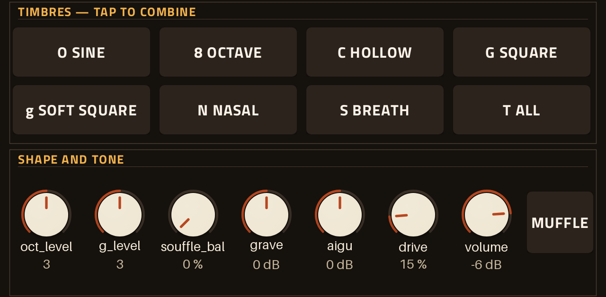

# Ondes

An Ondes Martenot-style instrument for Akai MPC OS standalone devices (MPC Live, One, X, Key, and Force), as a native
VST2 plugin with its own MPC screen skin. It models the signal chain of the 1970s transistor instrument (the "Model 7"):
one oscillator feeding the eight drawer timbres, the intensity key, the ribbon, keyboard vibrato and the transposition
buttons. Built on the shared wrapper from [open-mpc/mpc-vst-plugins](https://github.com/open-mpc/mpc-vst-plugins).

Ondes is an independent recreation, not affiliated with or endorsed by the makers of the original instrument.



**Status: 0.5.0.** Tested on an MPC Key 61 (Gen1, MPC OS 3.10.1). Only the Principal speaker is modelled so far; the
Palme (sympathetic strings), Résonance (spring reverb) and Métallique (gong) speakers are planned
([docs/DESIGN.md](docs/DESIGN.md), milestones M3 and M4).

## What it does

- **Eight timbres you combine**, all from one oscillator so they stay in phase: O Sine, 8 Octave (even harmonics),
  C Hollow (clipped triangle), G Square, g Soft Square (filtered, five steps), N Nasal (fixed-width pulse), S Breath (pink
  noise, with its own mix), T All. Checked against the harmonic chart in Jean Loriod's description of the instrument.
- **Intensity key:** the ondes is played by the left hand's volume key, not by key velocity. Pick its source
  (velocity, aftertouch, mod wheel, expression pedal or breath), its curve, dead zone and smoothing, and whether notes
  also gate the sound (Note + Intensity) or only the key does (Intensity Only, the real technique).
- **Ribbon mode:** pitch bend becomes the ring on its wire, a continuous slide of 1 to 4 octaves from the last key played.
  "Hold where left" keeps the pitch when your finger leaves an MPC touch strip, which springs back to the centre.
- **Keyboard mode** with glide and bend range, **hand vibrato** (mod wheel or aftertouch depth, with slow random drift so it
  doesn't sound like an LFO), and the six **transposition buttons**: -1/4, +1/4, +1/2, +1 tone, +3rd, +5th (they add up).
- **Voices:** Legato (overlapping notes slide, one attack: the instrument's own way), Mono (re-attacks every note) or Poly
  (6 voices).
- **Muffle** (felt) filter, Bass and Treble, amplifier drive, the Principal speaker's voicing.
- **Presets** in the plugin's PRESET field: ten built in, then the presets you save with MPC (read from
  `MPC Documents/Plugin Presets/Instruments/<plugin folder>/` when the plugin loads).
- **Strip Notes Up:** the Key 61's touch strip in Notes mode plays its scale in the lowest octave; this lifts notes at
  MIDI 36 and below by 1 to 3 octaves.

## Pages

| Page | Controls |
|---|---|
| SOUND | the eight timbre buttons; Octave Level, Soft Tone, Breath Mix, Bass, Treble, Drive, Volume; Muffle |
| PLAY | Keyboard / Ribbon; Voices; Strip Notes Up; Glide and Bend Range (keyboard) or Ribbon Range and Hold (ribbon); Octave, Fine Tune, Smoothing; the six transposition buttons |
| EXPRESSION | intensity source and articulation, curve, dead zone, smoothing; vibrato source, rate, depth, drift; note attack and release |

The Q-Links follow the page on screen.

## Playing it on an MPC Key

- For the ondes feel: EXPRESSION page, Source **Pedal** (an expression pedal in the Key's jack) or **Aftertouch**,
  Articulation **Intensity Only**. Keys then only choose the pitch and the pedal shapes every note.
- For slides: PLAY page, **Ribbon**, and set the touch strip to pitch bend.
- Mod wheel: vibrato depth.

## CPU

Measured with `tools/bench.sh` from mpc-vst-plugins on an MPC Key 61: typical patches play at about 3% of one core's
audio block. The heaviest case (Poly, all six voices, every timbre, Breath, Muffle and Drive on) reaches about 16% (p99),
rated WARN: fine for one or two instances in a normal project, not for many. The full result ships in each release's
`INSTALL.md`.

## Install

From the catalog (the Plugin Manager or the open-mpc catalog site), or from a release zip: run its `install.sh` on the
device, or on MPC OS 3.10.1 and later copy its `portable/<plugin folder>` into `<drive>/VST2 Plugins/` and restart MPC.
`INSTALL.md` in the zip has both ways.

## Build and test

Needs a checkout of [mpc-vst-plugins](https://github.com/open-mpc/mpc-vst-plugins) next to this repo, Docker and Python 3.

```
../mpc-vst-plugins/tools/build_port.sh vst/vst.json     # armv7 .so, skin and plugin-list entry in vst/build/
../mpc-vst-plugins/tools/test_port.sh vst/vst.json      # the wrapper's host test (x86, ASan)
tests/run.sh                                            # timbres, pitch, voices, presets (host compiler, ASan/UBSan)
```

`probe/midiprobe/` is a small diagnostic plugin (not shipped) that shows and logs the MIDI an MPC delivers to a VST2
instrument; it was used to design the ribbon and intensity controls.

## Credits and references

- Signal chain and timbre spectra: Jean Loriod's description of the Model 7 (block diagram, overall scheme and timbre
  table), and the factory documents and schematics collected by [The Ondes Martenot Archives](https://ondes.net).
- [svgeesus/ondesModulaire](https://github.com/svgeesus/ondesModulaire), a modular rebuild of the same chain, for the
  transposition intervals and timbre topology.
- The intensity key's behaviour: "Intensity Key of the Ondes Martenot: An Early Mechanical Haptic Device"
  (Sorbonne Université, HAL hal-01587642).
- The plugin wrapper, skin tools, tests and catalog are the work of the mpc-vst-plugins project.

None of the reference documents are in this repo.

## Licence

GPL-3.0-or-later. See [LICENSE](LICENSE).
